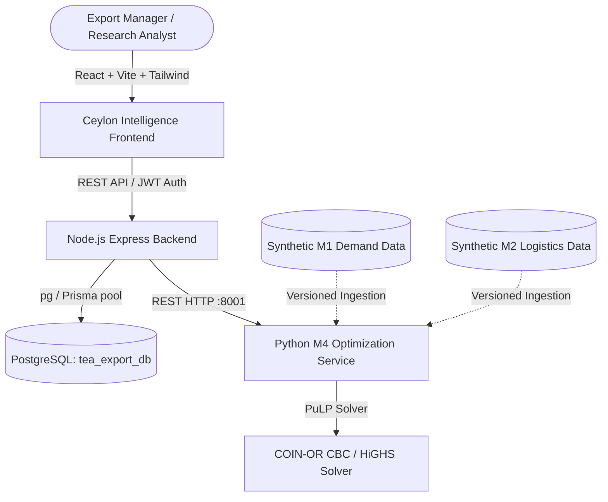

# Ceylon Intelligence: System Architecture & Research Overview

## AI-Based Decision Support System for Sri Lankan Tea Export Operations
### M4 — Prescriptive Export & Logistics Optimization Engine

---

## 1. System Context & Overview
Ceylon Intelligence is a prescriptive analytics and mathematical optimization platform tailored for Sri Lankan tea export operations. The M4 component formulates and solves Mixed-Integer Linear Programming (MILP) models to minimize total expected export costs subject to market demand, procurement supply, logistics routes, port handling, packaging, and risk constraints.

---

## 2. Component Structure

### A. Frontend (`frontend/src/modules/M4`)
- **Technology**: React 19, TypeScript, Vite, Tailwind CSS, Framer Motion, TanStack React Query, React Router, Recharts, Lucide React.
- **Visual Identity**: Inspired by Sri Lanka Tea Board and Ceylon Tea heritage.
  - Colors: Deep Forest Green (`#123D2B`), Tea Leaf Green (`#286B45`), Warm Ivory (`#F8F5ED`), Pale Tea Green (`#E8F0E5`), Antique Gold (`#C6A15B`), Charcoal (`#202922`).
  - Typography: Playfair Display / Serif headings, Inter / Sans-serif data & controls.
- **M4 Pages**:
  - `M4DashboardPage.tsx`: High-level metrics, cost comparisons, recent optimization runs.
  - `OptimizationWorkspacePage.tsx`: Interactive scenario configuration & run trigger.
  - `ScenariosPage.tsx`: Saved scenario configurations and status tracking.
  - `ResultsPage.tsx`: Allocation tables, cost breakdown, baseline comparisons, PDF/CSV export.
  - `SensitivityPage.tsx`: Parameter variation experiments (freight cost, supply capacity, demand).
  - `BacktestingPage.tsx`: Quarterly evaluation against historical benchmarks.
  - `DatasetManagementPage.tsx`: Dataset preview, validation, versioning, and activation.
  - `ModelManagementPage.tsx`: Optimization model specifications and metadata registry.

### B. Backend API (`backend/src/modules/M4`)
- **Technology**: Node.js, Express.js, TypeScript, PostgreSQL (`pg` + Prisma).
- **Core Responsibilities**:
  - Secure JWT authentication with HttpOnly cookies & role-based access control (`Admin`, `Export Manager`, `Logistics Coordinator`, `Research Analyst`).
  - Scenarios CRUD, Dataset versioning, Optimization job orchestration, Audit logging.
  - Secure dispatching to Python optimization service (`http://localhost:8001/api/v1/M4/optimize`).
  - Persistence of solutions, decision variables, cost components, and sensitivity runs.

### C. Optimization Service (`optimization-service/app/M4`)
- **Technology**: Python 3.13, FastAPI, PuLP (COIN-OR CBC), pandas, NumPy, Pydantic.
- **Port**: `8001` (running independently from existing ML service on `8000`).
- **Core Mathematical Model**:
  - Decision Variables: $x_{m, g, r, p}$ = Quantity (kg) of tea grade $g$ shipped to market $m$ via route $r$ using packaging $p$.
  - Objective: Minimize $\sum (\text{Procurement} + \text{Packaging} + \text{Freight} + \text{Handling} + \text{Customs} + \text{Wastage} + \text{Penalties})$.
  - Constraints: Supply availability, market demand satisfaction, route capacity, packaging limits, grade eligibility, integer shipping increments.

---

## 3. Data Integrity & Research Ethics
- Synthetic inputs from M1 (demand forecasts) and M2 (logistics cost & risk predictions) are explicitly marked with `SYNTHETIC_DEMO`.
- No fake model training is claimed for M1 or M2.
- The optimization engine provides true deterministic solver outcomes with exact dual/sensitivity runs, execution timings, and verified feasibility checks.
