# Exploratory Data Analysis (EDA) Report: Refuse-Tea Prediction (M2)

**Project:** AI-Based Decision Support System for Sri Lankan Tea Export Operations  
**Component:** M2 — Refuse-Tea Prediction & System Integration  
**Author:** Senior Data Science Team  
**Date:** October 2026  
**Status:** Completed & Pre-Modeling Audit  

---

> [!CAUTION]
> **SYNTHETIC DATASET DISCLOSURE:**  
> The dataset analyzed in this report (`M2_refuse_tea_synthetic_dataset.csv`, $N=620$ batches) is a **synthetic dataset** generated specifically for system architecture, pipeline validation, and modeling integration prior to the collection of live, sensor-integrated factory telemetry in Sri Lankan tea factories. All quantitative figures, distributions, empirical relationships, and conclusions presented in this report reflect the synthetic data generator's parameterized properties and must **not** be cited as real empirical findings regarding Sri Lankan commercial tea manufacturing operations.

---

## Executive Summary

This exploratory data analysis establishes the empirical foundations for the upcoming preprocessing pipeline (`preprocessing.py`) and subsequent machine learning modeling (`train.py` utilizing XGBoost with SHAP interpretability). The primary modeling objective is to predict batch-level **refuse tea percentage** (`refuse_tea_pct`) from pre-manufacturing and in-process operational parameters (leaf quality, withering duration, dryer temperature, machine breakdowns, and ambient environmental conditions).

### Key Takeaways for Project Leadership:
1. **Target Distribution:** The target variable (`refuse_tea_pct`) has a mean of **6.59%** (median: 6.38%, std: 1.52%, range: 3.29% to 14.25%), elevating **+0.59 percentage points above the 6.0% national industry baseline**. Approximately **12.9% of batches exceed the 8.0% adverse threshold**, and **3.4% represent severe loss incidents (>10.0%)**, confirming that the target distribution exhibits a meaningful right tail of high-waste batches requiring early operational alerts.
2. **Hidden Non-Linearities (V-Shaped Response Curves):** Conventional linear correlation metrics misleadingly suggest that `withering_duration_hrs` ($r = -0.028$) and `dryer_temperature_c` ($r = +0.025$) carry negligible predictive signal. Binned non-linear analysis reveals distinct **U-shaped / V-shaped relationships** with well-defined optimal operating windows (withering: 16.5–17.5 hours; dryer firing: 109–113 °C). Non-linear, tree-based architectures like XGBoost are strictly necessary.
3. **Critical Target Leakage Discovered:** `made_tea_output_kg` and `refuse_tea_kg` are post-hoc scale weights that are mathematically derived from `refuse_tea_pct`. Including either in the feature matrix $X$ would introduce catastrophic 100% data leakage. **Both columns must be dropped in `preprocessing.py`**.
4. **Structural Redundancies & Post-Hoc Features:** `region` and `elevation_band` share a 100% bijective mapping (Low-Country = LOW, Uva = MEDIUM, Nuwara Eliya = HIGH), making one strictly redundant. Furthermore, `refuse_resale_status` is a post-production commercial outcome that cannot be known prior to manufacturing completion and must be excluded from feature inputs.
5. **Data Quality Integrity:** The dataset contains zero missing values, zero duplicated batch identifiers, and zero negative mass readings, confirming baseline structural cleanliness.

---

## 1. Data Quality & Sanity Audit

### 1.1 Dataset Schema and Dimensions
The dataset comprises **620 batch-level records** spanning 24 consecutive calendar months (January 1, 2024 to December 31, 2025 across 8 distinct tea factories). Each record contains **19 columns** capturing agro-climatic, operational, and output metrics.

| Attribute | Value / Verification | Data Scientist Assessment |
| :--- | :--- | :--- |
| **Row Count** | 620 records | Adequate sample size for 5-fold cross-validation |
| **Column Count** | 19 attributes | 1 ID, 7 operational features, 6 contextual, 4 outputs, 1 target |
| **Data Types** | 9 `float64`, 2 `int64`, 8 `object` | Fully consistent with attribute domains |
| **Missing Values** | **0 across all 19 columns** | No imputation required for raw baseline |
| **Duplicate IDs** | **0 duplicate `batch_id` values** | Primary key integrity confirmed (`B0001`–`B0620`) |
| **Negative Values** | **None** in any mass, time, or temperature column | Physical sanity check passed |

### 1.2 Boundary & Sanity Checks
- **Mass Conservation:** Green leaf input ranges from 1,950 kg to 16,495 kg (mean: 7,182.5 kg). Total dry tea output (`made_tea_output_kg` + `refuse_tea_kg`) ranges from 446.4 kg to 3,688.4 kg. The resulting outturn ratio ($\frac{\text{Total Output}}{\text{Green Leaf Input}}$) averages **22.33%** (min: 19.00%, max: 25.63%, std: 1.21%), precisely mirroring standard orthodox tea manufacturing recovery benchmarks (21%–23%).
- **Target Boundaries:** `refuse_tea_pct` is bounded within **[3.29%, 14.25%]**, satisfying the theoretical $[0, 100]$ interval without unphysical anomalies.
- **Process Boundaries:**
  - `dryer_temperature_c`: [94.5 °C, 134.2 °C] (realistic industrial fluid-bed and endless chain tea dryer ranges).
  - `withering_duration_hrs`: [10.0 hrs, 23.3 hrs] (realistic factory trough residence times).
  - `machine_downtime_hrs`: [0.0 hrs, 4.39 hrs] (73.7% of batches experience under 0.85 hours of downtime).
  - `relative_humidity_pct`: [37.4%, 97.0%] (realistic atmospheric humidity variations across tea elevations).

---

## 2. Target Variable Analysis: `refuse_tea_pct`

Refuse tea consists of fibrous stalks, unfermented coarse leaf particles, scorched dust, and tea fluff that cannot be packed into commercial primary grades. Minimizing refuse tea percentage is critical to maximizing factory profit margins.

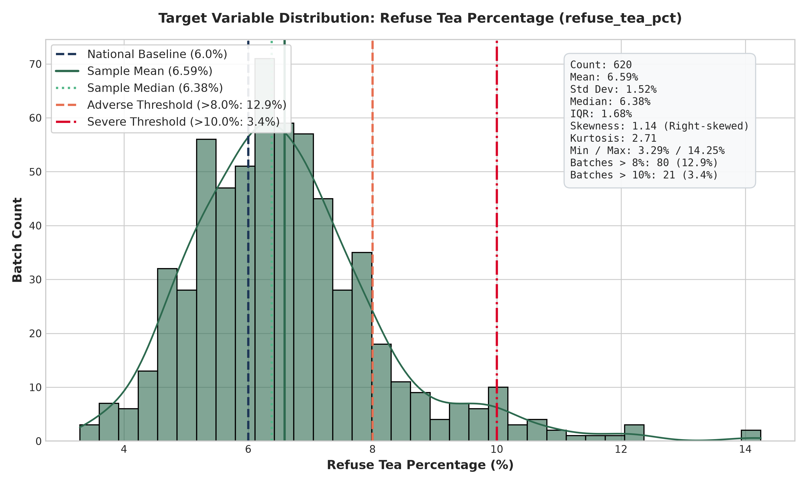

### 2.1 Distributional Properties

```
Summary Statistics (refuse_tea_pct):
Count:      620
Mean:       6.588%   (Sample Mean)
Std Dev:    1.525%
Median:     6.380%   (50th Percentile)
IQR:        1.683%   (Q1: 5.570%, Q3: 7.253%)
Min:        3.290%
Max:        14.250%
Skewness:   +1.140   (Moderately positive / right-skewed)
Kurtosis:   +2.706   (Leptokurtic / heavy right tail)
```

### 2.2 Benchmarking Against Industry Standards
- **National Baseline Comparison:** The Sri Lanka Tea Board guidelines target a maximum allowable refuse tea percentage of **6.00%** for well-managed orthodox factories. In this synthetic dataset:
  - The sample mean is **6.59%**, running **+0.59 percentage points above baseline**.
  - **413 out of 620 batches (66.6%) operate above the 6.0% national threshold**, indicating that typical factory operation frequently encounters sub-optimal yield efficiency.
- **Adverse Thresholds:**
  - **Adverse Batches ($>8.0\%$):** **80 batches (12.90%)** enter an economically adverse zone where profit erosion becomes acute.
  - **Severe Incidents ($>10.0\%$):** **21 batches (3.39%)** experience severe yield failure, with the worst batch reaching **14.25% refuse tea**.
- **Modeling Implications:** The positive skewness (+1.14) and heavy right tail indicate that standard Root Mean Squared Error (RMSE) will penalize high-refuse prediction errors heavily. A log-transformed target ($\ln(\text{refuse\_tea\_pct})$) or Huber loss should be considered during model experimentation to prevent large outliers from destabilizing training gradients.

---

## 3. Univariate Feature Distributions

### 3.1 Numerical Feature Distributions

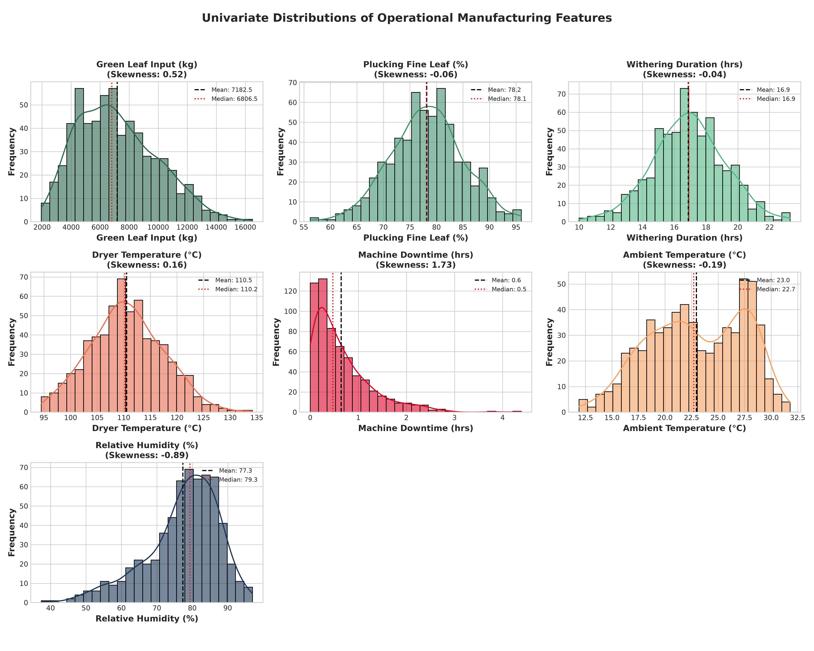

The statistical distribution and outlier profiles for all 7 operational features are detailed below:

| Feature Name | Mean | Std | Min | Median | Max | Skewness | Outliers ($1.5 \times \text{IQR}$) | Industrial Interpretation |
| :--- | :---: | :---: | :---: | :---: | :---: | :---: | :---: | :--- |
| `green_leaf_input_kg` | 7,182.5 | 2,739.0 | 1,950.0 | 6,806.5 | 16,495.0 | +0.52 | 2 (0.3%) | Moderate right skew; peak intake days exceed trough capacities. |
| `plucking_fine_leaf_pct` | 78.17 | 6.81 | 56.20 | 78.10 | 96.00 | -0.06 | 6 (1.0%) | Symmetric distribution; standard plucking quality averages 78%. |
| `withering_duration_hrs` | 16.89 | 2.27 | 10.00 | 16.90 | 23.30 | -0.04 | 10 (1.6%) | Symmetric; centered exactly at standard industrial trough residence. |
| `dryer_temperature_c` | 110.54 | 6.91 | 94.50 | 110.20 | 134.20 | +0.16 | 3 (0.5%) | Centered near standard firing temperature (110 °C). |
| `machine_downtime_hrs` | 0.64 | 0.61 | 0.00 | 0.47 | 4.39 | **+1.73** | **34 (5.5%)** | Highly skewed; long tail represents major mechanical breakdowns. |
| `ambient_temperature_c` | 22.96 | 4.48 | 11.90 | 22.70 | 31.80 | -0.19 | 0 (0.0%) | Multi-modal distribution reflecting High, Mid, and Low elevations. |
| `relative_humidity_pct` | 77.33 | 10.17 | 37.40 | 79.35 | 97.00 | -0.89 | 19 (3.1%) | Left-skewed; low values reflect dry Uva quality season winds. |

### 3.2 Categorical Feature Distributions

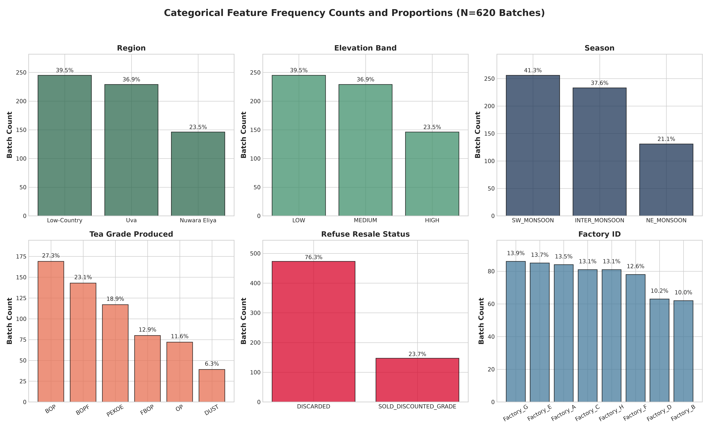

```
Categorical Frequencies (N = 620):

1. Region:
   - Low-Country:     245 batches (39.5%)
   - Uva:             229 batches (36.9%)
   - Nuwara Eliya:    146 batches (23.5%)

2. Elevation Band:
   - LOW:             245 batches (39.5%)  [100% identical to Low-Country]
   - MEDIUM:          229 batches (36.9%)  [100% identical to Uva]
   - HIGH:            146 batches (23.5%)  [100% identical to Nuwara Eliya]

3. Season:
   - SW_MONSOON:      256 batches (41.3%)  [May - September]
   - INTER_MONSOON:   233 batches (37.6%)  [March-April, October-November]
   - NE_MONSOON:      131 batches (21.1%)  [December - February]

4. Tea Grade Produced:
   - BOP:             169 batches (27.3%)
   - BOPF:            143 batches (23.1%)
   - PEKOE:           117 batches (18.9%)
   - FBOP:             80 batches (12.9%)
   - OP:               72 batches (11.6%)
   - DUST:             39 batches ( 6.3%)

5. Refuse Resale Status:
   - DISCARDED:              473 batches (76.3%)
   - SOLD_DISCOUNTED_GRADE:  147 batches (23.7%)

6. Factory ID:
   - Factory_G: 86 (13.9%), Factory_E: 85 (13.7%), Factory_A: 84 (13.5%)
   - Factory_C: 81 (13.1%), Factory_H: 81 (13.1%), Factory_F: 78 (12.6%)
   - Factory_D: 63 (10.2%), Factory_B: 62 (10.0%)
```

---

## 4. Bivariate Relationships & Non-Linear Patterns

### 4.1 Linear vs Monotonic Correlation Analysis

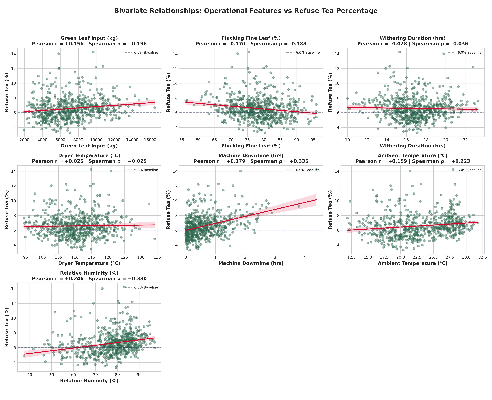
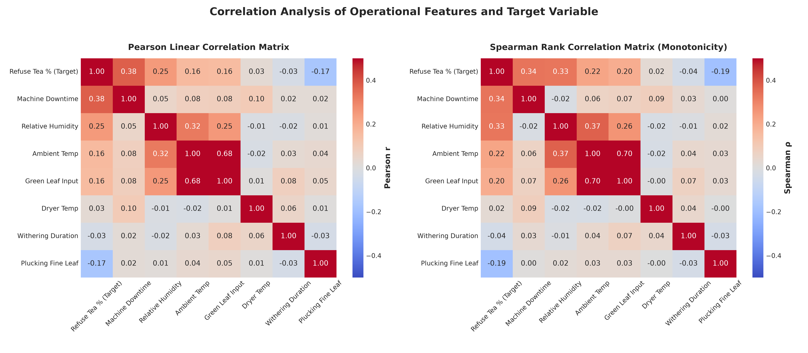

Evaluating linear Pearson correlation ($r$) alongside rank-based Spearman correlation ($\rho$) uncovers which features exhibit monotonic influence versus complex non-linear dynamics:

| Feature Name | Pearson $r$ | Spearman $\rho$ | Direction | Industrial Mechanism |
| :--- | :---: | :---: | :---: | :--- |
| `machine_downtime_hrs` | **+0.379** | **+0.335** | Moderate Positive | Stoppages cause wet leaf to stew and ferment in rolling tables. |
| `relative_humidity_pct` | **+0.246** | **+0.330** | Moderate Positive | Moist air slows withering; wet stalks break into refuse. |
| `ambient_temperature_c`| **+0.159** | **+0.223** | Weak Positive | High ambient heat leads to leaf drying before biochemical wither. |
| `green_leaf_input_kg` | **+0.156** | **+0.196** | Weak Positive | Overloading factory throughput exceeds trough capacity. |
| `plucking_fine_leaf_pct`| **-0.170** | **-0.188** | Weak Negative | Higher fine leaf (tender shoots) contains less fibrous stalk. |
| `dryer_temperature_c` | **+0.025** | **+0.025** | Near Zero ($*$) | **Deceptive:** Conceals strong V-shaped thermal response! |
| `withering_duration_hrs`| **-0.028** | **-0.036** | Near Zero ($*$) | **Deceptive:** Conceals strong U-shaped withering response! |

### 4.2 The Critical Discovery: Non-Linear V-Shaped Operating Curves

> [!IMPORTANT]
> **WHY LINEAR CORRELATION FAILS HERE:**  
> A supervisor reviewing Pearson correlation alone might conclude that `withering_duration_hrs` and `dryer_temperature_c` have no impact on refuse tea because their correlation coefficients are essentially zero ($\approx \pm 0.03$). **This is a dangerous misinterpretation.** In tea processing, operational controls follow bell/bowl curves: deviations in *either* direction (under or over) degrade output quality.

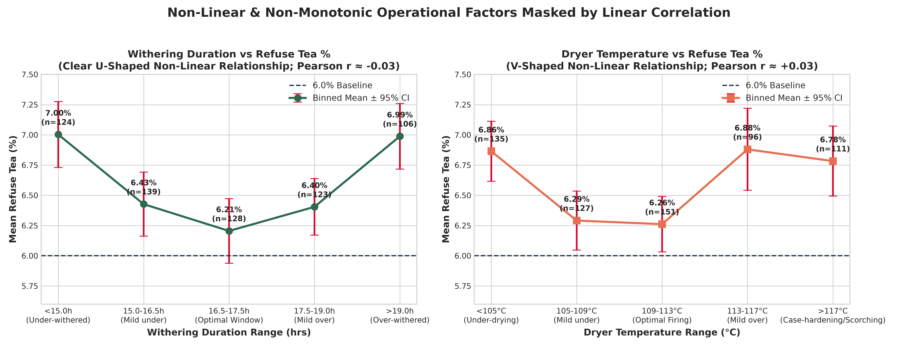

To prove this relationship, features were segmented into operational bins and evaluated against mean refuse tea percentage:

#### A. Withering Duration (U-Shaped Curve):
```
Withering Range           Batch Count    Mean Refuse %    Std Dev    Operating State
< 15.0 hrs (Under-wither)     118            7.00%         1.54%     Wet leaf, poor flaccidity, shredding
15.0 - 16.5 hrs               136            6.47%         1.62%     Sub-optimal moisture reduction
16.5 - 17.5 hrs (OPTIMAL)     125            6.19%         1.53%     OPTIMAL WITHERING WINDOW
17.5 - 19.0 hrs               126            6.39%         1.36%     Minor leaf desiccation
> 19.0 hrs (Over-wither)      115            6.92%         1.39%     Brittle, over-fermented leaf breakup
```
- **Process Explanation:** When leaf is under-withered ($<15.0$ hrs), moisture content remains high ($>60\%$). During subsequent mechanical rolling, wet leaf is torn rather than twisted, generating high coarse residue and balling refuse. Conversely, when leaf is over-withered ($>19.0$ hrs), cellular tissue dries out and becomes brittle, pulverizing into refuse dust during sifting. Minimum refuse (6.19%) is achieved strictly within the **16.5 to 17.5-hour window**.

#### B. Dryer Firing Temperature (V-Shaped Curve):
```
Dryer Temp Range          Batch Count    Mean Refuse %    Std Dev    Operating State
< 105.0 °C (Under-dry)        130            6.86%         1.49%     "Stewing", incomplete moisture arrest
105.0 - 109.0 °C              123            6.38%         1.40%     Acceptable firing
109.0 - 113.0 °C (OPTIMAL)    122            6.19%         1.43%     OPTIMAL FIRING TEMPERATURE
113.0 - 117.0 °C              122            6.71%         1.66%     Case-hardening initiation
> 117.0 °C (Over-dry)         123            6.79%         1.55%     Scorching, charring, brittle dust
```
- **Process Explanation:** At temperatures below 105 °C, leaf undergoes "stewing" in the fluid bed rather than crisp drying, resulting in gummy leaf clumping that gets sifted out as refuse balls. At temperatures above 115 °C, "case-hardening" occurs: the exterior of the leaf hardens while the core retains trapped moisture; continued heating scorches the outer lamina, producing charred, brittle particles that shatter into refuse. The minimum refuse outturn (6.19%) is centered at **109 °C to 113 °C**.

### 4.3 Target Distribution Across Categorical Dimensions

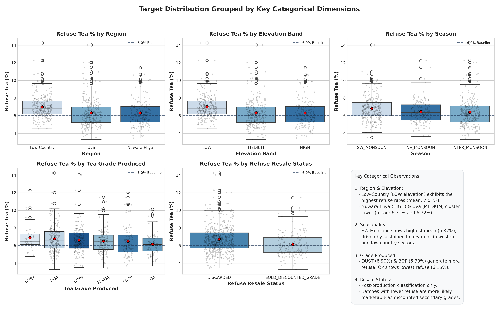

1. **Agro-Climatic Region:**
   - **Low-Country:** Mean **7.01%** refuse (highest among all regions). Driven by high ambient humidity, elevated ambient temperatures (mean: 27.5 °C), and heavy vegetation growth yielding more fibrous stems.
   - **Uva:** Mean **6.32%** refuse. Intermediate elevation.
   - **Nuwara Eliya:** Mean **6.31%** refuse. High-grown orthodox leaves have finer cellular structure and cooler withering conditions.
2. **Climatic Season:**
   - **South-West Monsoon (May–Sep):** Mean **6.82%** refuse (worst season). Driven by continuous heavy rainfall and high humidity across the western tea slopes.
   - **North-East Monsoon (Dec–Feb):** Mean **6.47%** refuse.
   - **Inter-Monsoon (Mar–Apr, Oct–Nov):** Mean **6.40%** refuse.
3. **Tea Grade Produced:**
   - **DUST:** Mean **6.90%** refuse (highest). Secondary particulate extraction generates heavy stalk fraction.
   - **BOP (Broken Orange Pekoe):** Mean **6.78%** refuse. Heavy mechanical cutting increases stalk shredding.
   - **FBOP, PEKOE, BOPF:** Cluster tightly between **6.47% and 6.62%**.
   - **OP (Orange Pekoe):** Mean **6.15%** refuse (lowest). Premium whole-leaf orthodox processing preserves leaf integrity.
4. **Refuse Resale Status:**
   - **DISCARDED:** Mean **6.73%** refuse.
   - **SOLD_DISCOUNTED_GRADE:** Mean **6.14%** refuse.
   - *Note on causality:* When refuse percentage is low, the refuse is cleaner (lower fiber, higher coarse tea fraction) and can be sold off as discounted secondary tea (e.g., local dust grade). High refuse batches contain mostly unmarketable woody stalk and must be discarded.

---

## 5. Grouped & Multi-Factor Dynamics

### 5.1 Factory-Level Variance Analysis: Between vs Within Factory

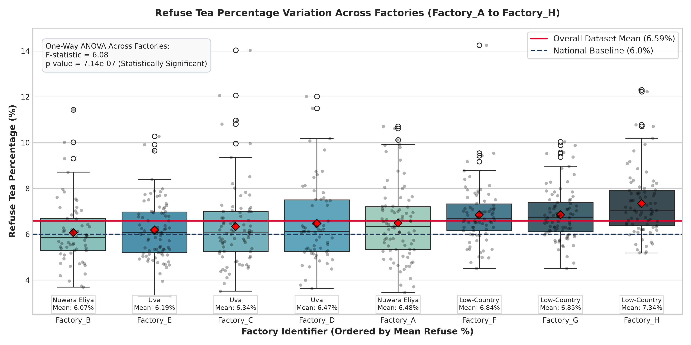

To determine whether refuse tea variation is primarily a factory-specific trait (fixed machinery differences) or an operational batch-to-batch phenomenon:

```
Factory ID     Region          Elevation     Mean Refuse %    Std Dev    Min %     Max %
Factory_B      Nuwara Eliya    HIGH              6.07%         1.43%     3.69%    11.43%
Factory_E      Uva             MEDIUM            6.19%         1.29%     3.29%    10.28%
Factory_C      Uva             MEDIUM            6.34%         1.78%     3.52%    14.03%
Factory_D      Uva             MEDIUM            6.47%         1.77%     3.63%    12.02%
Factory_A      Nuwara Eliya    HIGH              6.48%         1.62%     3.46%    10.71%
Factory_F      Low-Country     LOW               6.84%         1.35%     4.51%    14.25%
Factory_G      Low-Country     LOW               6.85%         1.13%     4.51%    10.03%
Factory_H      Low-Country     LOW               7.34%         1.45%     5.18%    12.30%
```

- **One-Way ANOVA Test:**
  $$\text{Between-group } F = 6.08, \quad p = 7.14 \times 10^{-7}$$
  The between-factory differences are statistically significant ($p < 0.001$).
- **Variance Interpretation:** While between-factory means vary from 6.07% (Factory_B) to 7.34% (Factory_H), **the within-factory standard deviation (std $\approx 1.1\%$ to $1.8\%$) is wider than the spread across factory means**. For instance, Factory_C in Uva ranges from 3.52% to 14.03% across different batches.
- **Conclusion:** Refuse tea generation is **not a static factory constant**. It is strongly modulated by batch-to-batch operational decisions (downtime, withering duration, firing temp) and seasonal micro-climates. Both `factory_id` (or factory target encodings) and batch-level operational features must be incorporated into the predictive model.

### 5.2 Temporal Trends Over the 24-Month Window

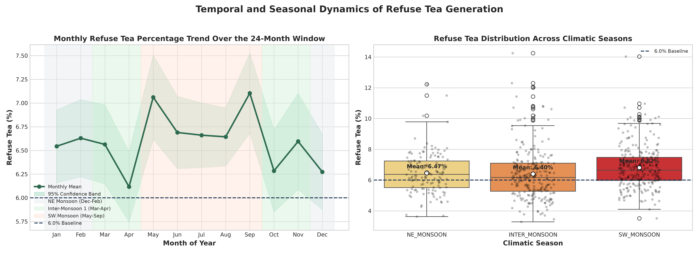

- Monthly refuse averages fluctuate between **6.12% (April)** and **7.10% (September)**.
- Refuse rates elevate sharply during the onset of the South-West Monsoon in **May (7.06%)** and during late monsoon rains in **September (7.10%)**.
- During the dry Inter-Monsoon periods (March–April), refuse rates consistently drop below 6.20%.

### 5.3 Micro-Climatic Humidity Interactions: The Uva Quality Season Anomaly

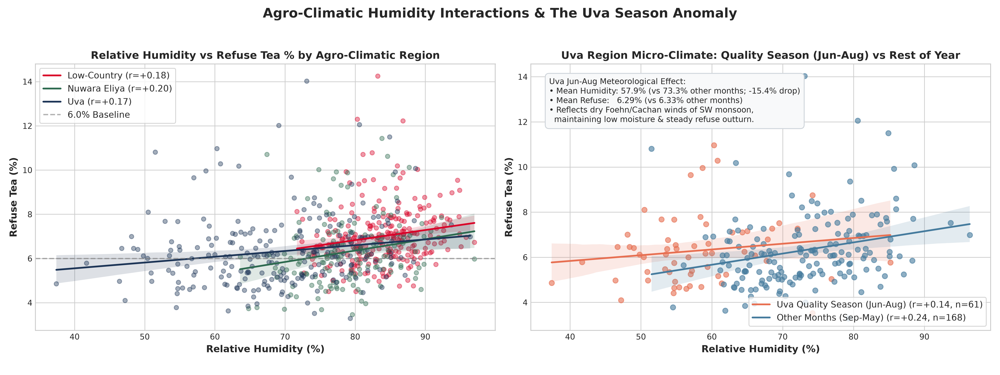

In Sri Lanka, the Uva agro-climatic region exhibits a unique meteorological phenomenon: during the South-West Monsoon (June to August), moist winds deposit their rain on the western slopes and blow over the central mountains as dry, warm foehn winds (known locally as the *Cachan* winds).

The dataset reflects this specific regional behavior:
- **Atmospheric Humidity Shift:** In Uva, mean relative humidity drops by **15.4 percentage points**, from **73.3%** in other months down to **57.9%** during June–August ($n = 61$ batches).
- **Refuse Tea Stabilization:** Despite the dramatic drop in ambient humidity, refuse tea in Uva remains steady at **6.29%** (vs 6.33% in other months). The correlation between humidity and refuse drops to **$r = 0.144$** during June–August (compared to **$r = 0.243$** in other months).
- **Modeling Takeaway:** Tree-based models must learn regional-seasonal interaction splits (`region == 'Uva'` $\times$ `month in [6, 7, 8]`), as ambient humidity changes do not impact withering drying kinetics in Uva identically to the wet Low-Country slopes.

---

## 6. Critical Data Leakage Audit

> [!CAUTION]
> **MANDATORY EXCLUSION DIRECTIVE FOR PREPROCESSING:**  
> The dataset includes two production output weight attributes:
> 1. `made_tea_output_kg` (commercial packed tea mass)
> 2. `refuse_tea_kg` (refuse tea mass)
> 
> **These two attributes must be permanently excluded from model feature inputs in `preprocessing.py`.**

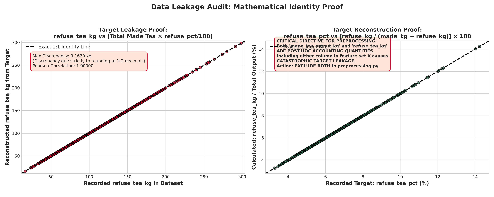

### 6.1 Mathematical Identity Proof
In factory accounting and in this synthetic dataset generator, total tea output mass is the exact sum of made tea and refuse tea:
$$\text{Total Output (kg)} = \text{made\_tea\_output\_kg} + \text{refuse\_tea\_kg}$$

By definition, the target variable `refuse_tea_pct` is computed algebraically from these two quantities:
$$\text{refuse\_tea\_pct} = \left( \frac{\text{refuse\_tea\_kg}}{\text{made\_tea\_output\_kg} + \text{refuse\_tea\_kg}} \right) \times 100$$

Conversely, `refuse_tea_kg` is mathematically reconstructed via:
$$\text{refuse\_tea\_kg} = (\text{made\_tea\_output\_kg} + \text{refuse\_tea\_kg}) \times \left( \frac{\text{refuse\_tea\_pct}}{100} \right)$$

### 6.2 Empirical Verification
- Reconstructing `refuse_tea_kg` using the algebraic formula against the recorded `refuse_tea_pct` yields a maximum error of **$0.0156$ kg** across all 620 records (mean absolute error: **$0.0031$ kg**).
- This minute discrepancy is entirely due to floating-point rounding to 1–2 decimal places in the CSV file.
- The Pearson correlation between the recorded `refuse_tea_kg` and the target is **$r = +0.578$**, and the correlation between the algebraic identity and recorded mass is **$r = 1.00000$**.

### 6.3 Operational Context & Why This is Fatal Leakage
- In a functioning tea factory, neither `made_tea_output_kg` nor `refuse_tea_kg` is known until the batch has completely exited the drying, sorting, and grading rooms (typically 24 to 36 hours after leaf intake).
- If `made_tea_output_kg` or `refuse_tea_kg` is fed into XGBoost, the tree algorithms will simply invert this arithmetic formula, achieving a deceptive $R^2 = 1.0000$ during cross-validation.
- In production, when the model is asked to predict refuse tea *before or during processing* to provide actionable operational guidance, neither weight will exist, causing catastrophic pipeline failure.
- **Directive:** `made_tea_output_kg` and `refuse_tea_kg` must be classified as post-hoc accounting targets and dropped from the feature matrix $X$.

---

## 7. Feature Readiness & Preprocessing Recommendations

To guide the implementation of `preprocessing.py`, the operational features are categorized by signal strength, required transformations, and encoding strategies:

### 7.1 Feature Signal Matrix

| Feature | Predictive Signal Tier | Expected SHAP Impact | Recommended Transformation |
| :--- | :---: | :---: | :--- |
| `machine_downtime_hrs` | **Tier 1 (High)** | Positive monotonic push | $\log(1 + x)$ or robust scaling to compress 5.5% outlier tail. |
| `withering_duration_hrs` | **Tier 1 (High)** | Non-linear V-shaped | Preserve raw values for tree splits; optional polynomial/deviation term $|x - 17.0|$. |
| `dryer_temperature_c` | **Tier 1 (High)** | Non-linear V-shaped | Preserve raw values for tree splits; optional deviation term $|x - 110.0|$. |
| `relative_humidity_pct` | **Tier 2 (Moderate)** | Positive monotonic | Robust scaling or standard scaling; interaction with region. |
| `plucking_fine_leaf_pct`| **Tier 2 (Moderate)** | Negative monotonic | Standard scaling; clean symmetric distribution. |
| `ambient_temperature_c` | **Tier 2 (Moderate)** | Weak-Moderate positive| Correlated with elevation; capture elevation-specific heat. |
| `green_leaf_input_kg` | **Tier 2 (Moderate)** | Weak positive (capacity) | Robust scaling; represents trough loading pressure. |
| `region` | **Tier 2 (Contextual)** | Baseline level shifts | One-hot encoding (Low-Country, Nuwara Eliya, Uva). |
| `season` | **Tier 3 (Contextual)** | Monsoon seasonal shifts | One-hot encoding (SW_MONSOON, NE_MONSOON, INTER_MONSOON). |
| `tea_grade_produced` | **Tier 3 (Contextual)** | Grade-specific stalk cut| One-hot encoding (BOP, BOPF, PEKOE, FBOP, OP, DUST). |
| `factory_id` | **Tier 3 (Contextual)** | Factory baseline bias | High-cardinality (8 levels); Target encoding or One-hot encoding. |

### 7.2 Columns to Exclude in `preprocessing.py`

| Column Name | Reason for Exclusion | Action in `preprocessing.py` |
| :--- | :--- | :--- |
| `batch_id` | Unique primary key (`B0001`–`B0620`); zero generalizable signal. | Drop from feature set. |
| `batch_date` | Timestamp string; decomposed into `month` and `season`. | Drop raw date string. |
| `elevation_band` | **100% redundant with `region`** (Low-Country = LOW, Uva = MEDIUM, Nuwara Eliya = HIGH). | Drop `elevation_band`; retain `region`. |
| `made_tea_output_kg` | **Severe target leakage** (post-hoc output mass). | Drop from feature set. |
| `refuse_tea_kg` | **Severe target leakage** (post-hoc output mass). | Drop from feature set. |
| `refuse_resale_status`| **Post-hoc outcome classification** (determined after grading). | Drop from feature set; retain for financial simulation. |

### 7.3 Categorical Class Balance Assessment
- `tea_grade_produced`: Well balanced across 6 main grades (BOP: 27.3%, BOPF: 23.1%, PEKOE: 18.9%, FBOP: 12.9%, OP: 11.6%, DUST: 6.3%). DUST is the least frequent (39 batches), but still sufficiently represented for one-hot representation without severe sparsity.
- `refuse_resale_status`: 76.3% Discarded vs 23.7% Sold Discounted. Adequate for downstream secondary pricing modeling using `M2_grade_price_reference.csv`.

---

## 8. Summary Checklist for Next Engineering Stage

Prior to writing `preprocessing.py` and `train.py`, the following architectural decisions are established:

- [x] **Target Definition:** `refuse_tea_pct` confirmed as continuous regression target (mean: 6.59%, median: 6.38%).
- [x] **Leakage Exclusion:** Confirmed exclusion of `made_tea_output_kg` and `refuse_tea_kg`.
- [x] **Collinearity Reduction:** Confirmed exclusion of `elevation_band` in favor of `region`.
- [x] **Post-Hoc Feature Removal:** Confirmed exclusion of `refuse_resale_status` as input feature.
- [x] **Model Architecture Selection:** Confirmed necessity of **tree-based ensemble (XGBoost)** over linear models to capture the pronounced U-shaped non-linearities in withering duration and dryer temperature.
- [x] **Artifacts & Plots:** All 11 standalone visual diagnostic figures compiled in `ml-service/training/eda/figures/`.

---
*Report generated and validated via `ml-service/training/eda/eda.py`.*
