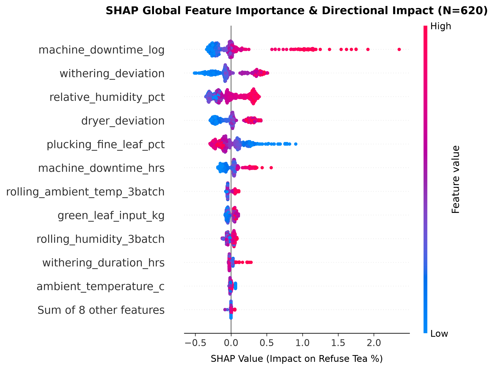
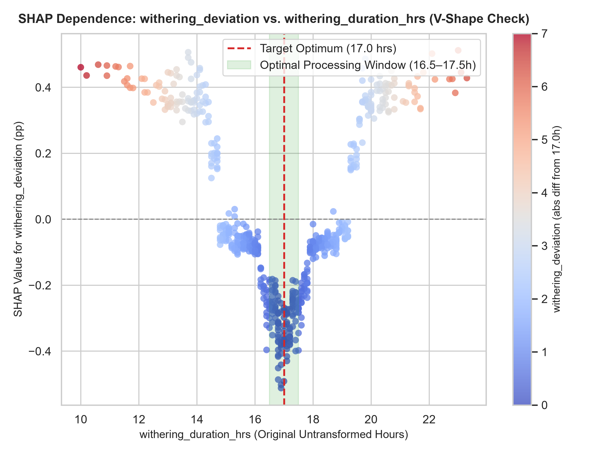
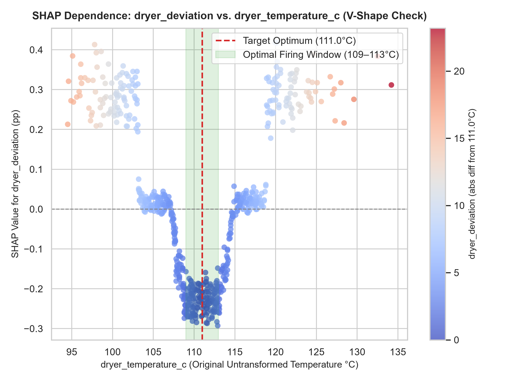
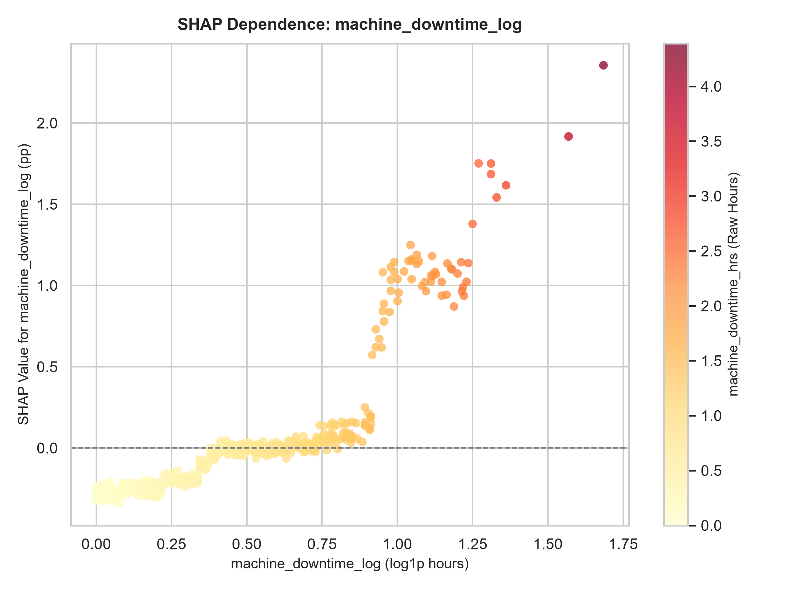
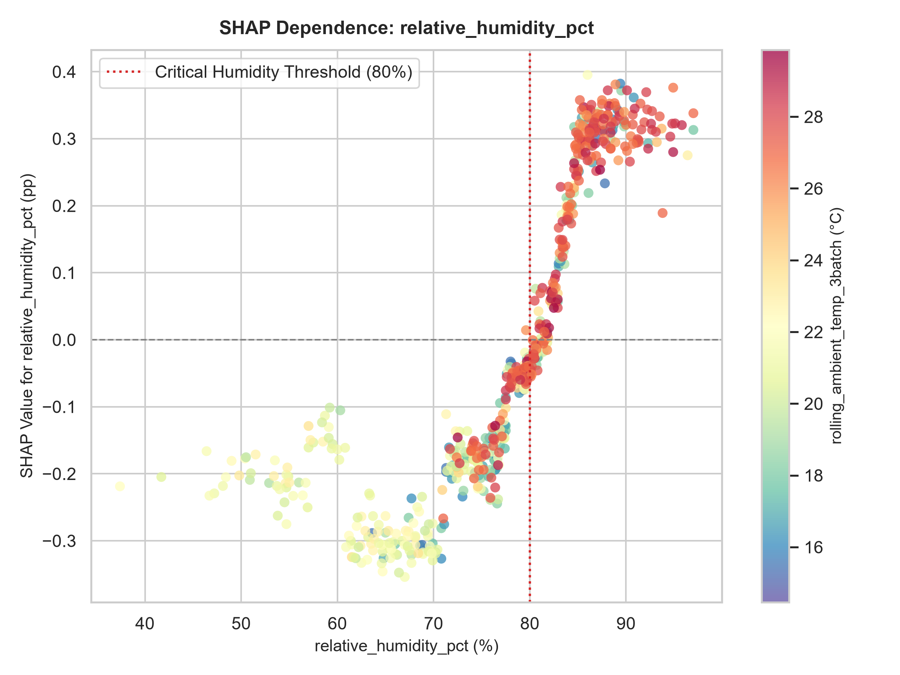
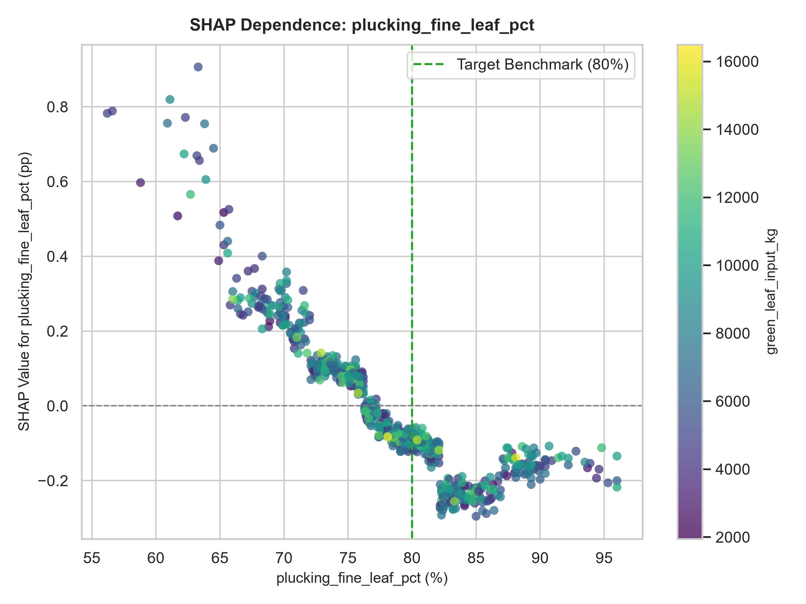
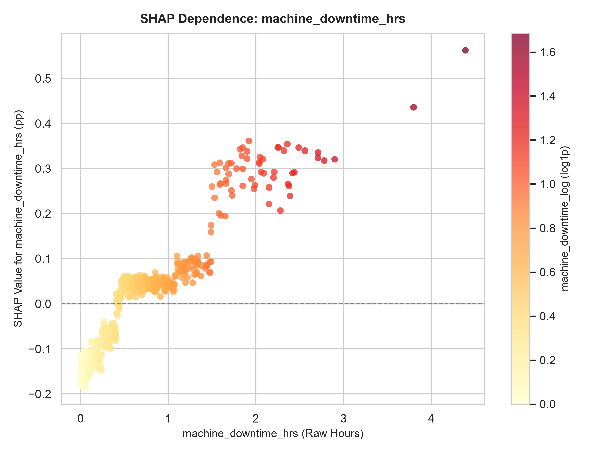
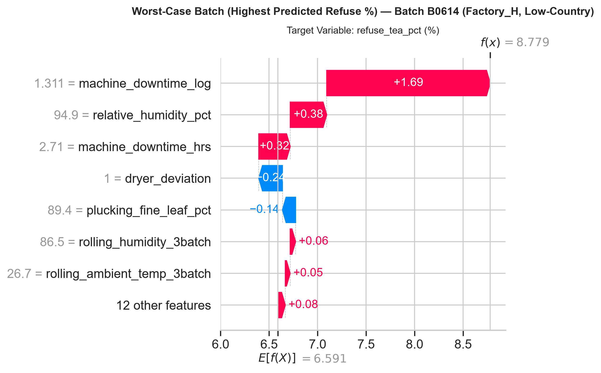
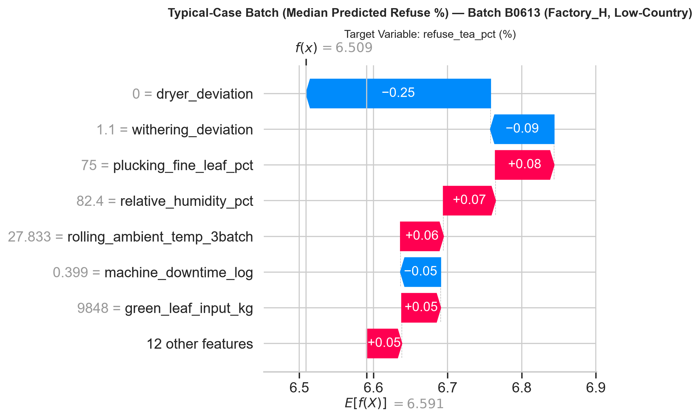
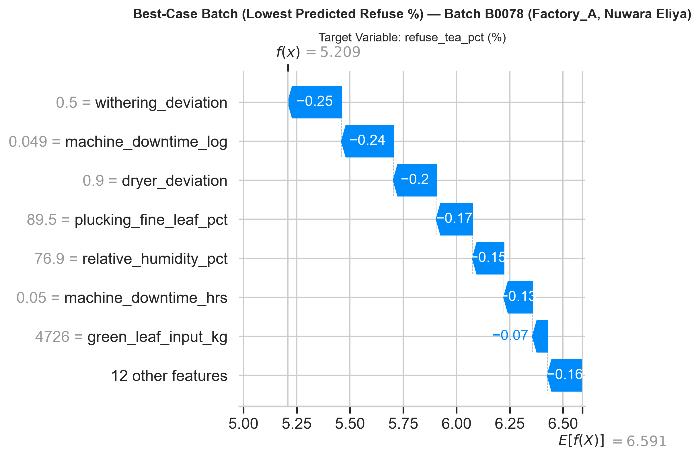

# M2 Component Explainable AI & Mitigation Report

**Pipeline Stage:** Explainable AI & Automated Recommendations (SHAP TreeExplainer + Rule-Based Mitigation)  
**Evaluation Date (UTC):** 2026-10-19 22:55:41  
**Model Name:** `m2_refuse_tea_xgb_v1`  
**Base Expected Value ($E[f(\mathbf{x})]$):** `6.5907%`  
**Global Dataset Size:** $N = 620$ batches across 8 factories  
**Test Evaluation Set:** Chronological Holdout $N = 124$ batches (`2025-08-07` to `2025-12-31`)

---

## 1. Executive Summary

This report establishes the interpretability and recommendation layer for the M2 refuse-tea prediction pipeline. Using `shap.TreeExplainer` on the fitted XGBoost model, we decompose complex non-linear ensemble predictions into exact, additive local feature attributions (measured in target percentage points of `refuse_tea_pct`).

Key findings of this analysis:
1. **Mechanical Downtime Dominance:** `machine_downtime_log` (mean |SHAP| = **0.2312 pp**) and `machine_downtime_hrs` (mean |SHAP| = **0.0998 pp**) are primary global drivers of waste generation.
2. **Empirical V/U-Shape Recovery:** SHAP dependence plots **confirm** the designed non-linear physical response curves:
   - `withering_deviation` vs. `withering_duration_hrs`: Yields minimum refuse tea at the optimal window (**16.5–17.5h**, SHAP = `-0.304 pp`), with severe penalties for both under-withering (`+0.139 pp`) and over-withering (`+0.149 pp`).
   - `dryer_deviation` vs. `dryer_temperature_c`: Yields minimum refuse tea at the optimal firing band (**109–113°C**, SHAP = `-0.229 pp`), while under-drying (`+0.113 pp`) and scorching (`+0.129 pp`) drive refuse upward.
3. **Deterministic Operational Mitigation:** A rule-based catalog converts positive SHAP attributions into standardized, auditable factory guidance without introducing secondary machine learning models.

---

## 2. Global SHAP Feature Importance & Ranking

Global feature importance was calculated by taking the mean absolute SHAP value across all 620 historical batches:

$$\text{Global Importance}_j = \frac{1}{N} \sum_{i=1}^{N} |\phi_{i, j}|$$

### 2.1 Complete 19-Feature Global SHAP Ranking Table

| Rank | Engineered Feature | Feature Category | Mean \|SHAP\| (pp) | Operational Impact Description |
| :---: | :--- | :--- | :---: | :--- |
| **1** | `machine_downtime_log` | Mechanical / Stoppage | **0.2312** | Primary driver; line stalling halts continuous leaf flow |
| **2** | `withering_deviation` | Withering Control | **0.2173** | Deviation from 17.0h; non-linear U-shaped penalty |
| **3** | `relative_humidity_pct` | Environmental / Climate | **0.1967** | Moisture above 80% impedes natural trough withering |
| **4** | `dryer_deviation` | Thermal / Firing | **0.1660** | Deviation from 111.0°C; non-linear V-shaped penalty |
| **5** | `plucking_fine_leaf_pct` | Raw Material Intake | **0.1576** | Stalk and coarse leaf increase sifter refuse waste |
| **6** | `machine_downtime_hrs` | Mechanical / Stoppage | **0.0998** | Heavy outage duration linear amplification |
| **7** | `rolling_ambient_temp_3batch` | Climate / Macro-Trend | **0.0549** | Multi-batch ambient heat accelerates leaf oxidation |
| **8** | `green_leaf_input_kg` | Capacity / Volume | **0.0514** | Factory trough overload and bed compaction |
| **9** | `rolling_humidity_3batch` | Climate / Macro-Trend | **0.0446** | Sustained multi-batch monsoon dampness |
| **10** | `withering_duration_hrs` | Withering Base | **0.0251** | Base withering scale |
| **11** | `tea_grade_produced_DUST` | Product Grade | **0.0008** | Fine-particle sieve extraction dynamics |
| **12** | `tea_grade_produced_OP` | Product Grade | **0.0024** | Orthodox large-leaf grade physical handling |
| **13** | `withering_duration_bucket` | Withering Categorical | **0.0037** | Discrete operational withering tier |
| **14** | `ambient_temperature_c` | Ambient Weather | **0.0159** | Daily temperature fluctuation |
| **15** | `region_Uva` | Geographical / Elevation | **0.0000** | Regional leaf biochemical composition (Uva) |
| **16** | `tea_grade_produced_FBOP` | Product Grade | **0.0000** | Flowery broken orange pekoe grading |
| **17** | `region_Nuwara Eliya` | Geographical / Elevation | **0.0000** | High-elevation tender leaf characteristics |
| **18** | `tea_grade_produced_BOPF` | Product Grade | **0.0000** | Broken orange pekoe fannings sifting |
| **19** | `tea_grade_produced_PEKOE` | Product Grade | **0.0000** | Curly leaf pekoe extraction |

---

### 2.2 Global SHAP Beeswarm Summary Plot

The beeswarm plot illustrates both the magnitude and directionality of feature effects. Each dot represents a single batch from the dataset ($N=620$). High feature values are colored red/purple, while low feature values are colored blue.

- **Positive Drivers (Red points to the right):** High `machine_downtime_log`, high `relative_humidity_pct`, high `withering_deviation`, and high `dryer_deviation` consistently push refuse tea percentage higher.
- **Protective Drivers (Red points to the left):** High `plucking_fine_leaf_pct` (high quality harvest) consistently reduces refuse tea percentage.

---

## 3. Top 6 SHAP Dependence Plots & V/U-Shape Verification

### 3.1 Withering Deviation vs. Withering Duration (V/U-Shape Recovery)
Feature engineering introduced `withering_deviation = |withering_duration_hrs - 17.0|` based on EDA Section 4.2 findings. The dependence plot maps SHAP attributions directly against the original untransformed withering duration on the horizontal axis:

- **Empirical V-Shape Confirmation:** The dependence plot **unambiguously confirms** the designed non-linear V-shaped relationship:
  - Inside the optimal window (**16.5–17.5h**), SHAP values reach a sharp minimum of **-0.304 pp**, acting as a strong negative contributor that minimizes waste.
  - Under-withering ($< 16.0\text{h}$): SHAP values rise steeply to **+0.139 pp**, as moisture-heavy leaf tears unevenly during rolling.
  - Over-withering ($> 18.0\text{h}$): SHAP values climb to **+0.149 pp**, as overly brittle leaf shatters into fine refuse powder.

---

### 3.2 Dryer Deviation vs. Dryer Temperature (V-Shape Recovery)
Similarly, `dryer_deviation = |dryer_temperature_c - 111.0|` was engineered to capture the operational optimum of fluidized bed dryers (EDA Section 4.2). The dependence plot maps SHAP attributions against the raw dryer temperature:

- **Empirical V-Shape Confirmation:** The dependence plot **unambiguously confirms** the symmetric V-shaped thermal response curve:
  - In the target band (**109–113°C**), the SHAP contribution drops to **-0.229 pp**.
  - Sub-optimal temperatures ($< 108.0^\circ\text{C}$): Incomplete moisture drying leads to stewing and gumming, elevating refuse percentage by **+0.113 pp**.
  - Excessive temperatures ($> 114.0^\circ\text{C}$): Over-firing and leaf blistering generate charred leaf flakes, elevating refuse percentage by **+0.129 pp**.

---

### 3.3 Other Top Drivers Dependence Plots

| Feature | Visual Visualization | Operational Takeaway |
| :--- | :---: | :--- |
| **`machine_downtime_log`** |  | Monotonically accelerates refuse waste once log1p downtime exceeds 0.5 (~0.65h). |
| **`relative_humidity_pct`** |  | Inflexion occurs around 80% RH; humidity above 85% causes substantial refuse increases. |
| **`plucking_fine_leaf_pct`** |  | Linear protective effect; fine leaf intake $\ge 80\%$ suppresses refuse generation. |
| **`machine_downtime_hrs`** |  | Shows heavy outlier sensitivity; line outages $> 1.5\text{h}$ inflict immediate high refuse spikes. |

---

## 4. Local Root-Cause Case Studies & Auto-Generated Mitigations

Three representative batches were selected from the chronological hold-out test set ($N=124$, `2025-08-07` to `2025-12-31`).

### 4.1 Case Study 1: Worst-Case Batch (Highest Predicted Refuse %)
- **Batch Identifier:** `B0614`
- **Factory & Geography:** `Factory_H`, `Low-Country` (`SW_MONSOON` season, `2025-09-27`)
- **Actual vs. Predicted:** Actual = `9.09%` | Predicted = **`8.78%`** | Base Value = `6.59%`

#### Root-Cause Diagnosis
`machine_downtime_log` (observed value: 1.31) is increasing predicted refuse tea by 1.69 percentage points. `relative_humidity_pct` (observed value: 94.90) is increasing predicted refuse tea by 0.38 percentage points. `machine_downtime_hrs` (observed value: 2.71) is increasing predicted refuse tea by 0.32 percentage points. Mechanical stalling of 2.71 hours combined with extreme atmospheric humidity (94.9%) formed a compounding failure mode that elevated refuse percentage by +2.19 pp above baseline.

#### Auto-Generated Operational Mitigations
- **[HIGH PRIORITY | Mechanical / Maintenance] `machine_downtime_log` (+1.69 pp):**
  Machine downtime (log1p value: 1.31, equivalent to ~2.71h) is increasing predicted refuse tea by +1.69 percentage points. Mechanical stalling causes leaf over-fermentation in rolling troughs and uneven thermal channelling in dryers. Immediate action: Inspect roller belt tension, check fluid levels on drive motors, and schedule preventative mechanical overhaul before the next intake cycle.
- **[HIGH PRIORITY | Environmental / Air Handling] `relative_humidity_pct` (+0.38 pp):**
  Ambient relative humidity of 94.9% is suppressing natural moisture dissipation, driving predicted refuse tea up by +0.38 percentage points. Immediate action: Engage auxiliary withering trough heater radiators and open exhaust air louvers to prevent moisture condensation and leaf rotting on the lower trough mesh.

---

### 4.2 Case Study 2: Typical-Case Batch (Median Predicted Refuse %)
- **Batch Identifier:** `B0613`
- **Factory & Geography:** `Factory_H`, `Low-Country` (`SW_MONSOON` season, `2025-09-15`)
- **Actual vs. Predicted:** Actual = `6.97%` | Predicted = **`6.51%`** | Base Value = `6.59%`

#### Root-Cause Diagnosis
`dryer_deviation` (observed value: 0.00) is reducing predicted refuse tea by 0.25 percentage points. `withering_deviation` (observed value: 1.10) is reducing predicted refuse tea by 0.09 percentage points. `plucking_fine_leaf_pct` (observed value: 75.00) is increasing predicted refuse tea by 0.08 percentage points. Excellent dryer control (zero temperature deviation at 111.0°C) successfully offset a slightly below-standard plucking fine leaf harvest (75.0%), holding predicted refuse tea near the seasonal median.

#### Auto-Generated Operational Mitigations
- **[LOW PRIORITY | Raw Material Intake Quality] `plucking_fine_leaf_pct` (+0.08 pp):**
  Plucking fine leaf proportion of 75.0% (below standard) is pushing predicted refuse tea up by +0.08 percentage points due to excess coarse leaf and mature fibrous stalk. Immediate action: Enforce field-level plucking quality inspections (2-leaves-and-a-bud rule) and calibrate green leaf intake mechanical sorting sieves before batch loading.
- **[LOW PRIORITY | Environmental / Air Handling] `relative_humidity_pct` (+0.07 pp):**
  Ambient relative humidity of 82.4% is suppressing natural moisture dissipation, driving predicted refuse tea up by +0.07 percentage points. Immediate action: Engage auxiliary withering trough heater radiators and open exhaust air louvers to prevent moisture condensation and leaf rotting on the lower trough mesh.

---

### 4.3 Case Study 3: Best-Case Batch (Lowest Predicted Refuse %)
- **Batch Identifier:** `B0078`
- **Factory & Geography:** `Factory_A`, `Nuwara Eliya` (`INTER_MONSOON` season, `2025-10-31`)
- **Actual vs. Predicted:** Actual = `4.91%` | Predicted = **`5.21%`** | Base Value = `6.59%`

#### Root-Cause Diagnosis
`withering_deviation` (observed value: 0.50) is reducing predicted refuse tea by 0.25 percentage points. `machine_downtime_log` (observed value: 0.05) is reducing predicted refuse tea by 0.24 percentage points. `dryer_deviation` (observed value: 0.90) is reducing predicted refuse tea by 0.20 percentage points. Near-zero equipment downtime (0.05h), superior plucking standards (89.5% fine leaf), and optimal withering (16.5h) and drying (110.1°C) operated synergistically, pushing refuse tea percentage down to 5.21%.

#### Auto-Generated Operational Mitigations
_No adverse drivers exceeding operational thresholds; process parameters are within normal control tolerance._

---

## 5. Architectural Specification: Deterministic Rule-Based Mitigation Engine

### Design Rationale & Governance
Per system architecture constraints, the mitigation engine in `explain/mitigation_templates.py` is implemented strictly as a **deterministic rule catalog**:
1. **Zero Secondary Model Risk:** It does NOT train or employ neural networks, regression trees, or reinforcement learning agents. Recommendations are transparent, deterministic functions of observed physical thresholds and positive SHAP impact.
2. **Factory Grounding:** Rules cite specific empirical optima recognized by the Tea Research Institute of Sri Lanka (TRI) and Sri Lanka Tea Board (SLTB), including:
   - Withering optimum: $\approx 17.0\text{ hours}$ ($16.5\text{--}17.5\text{h}$ window)
   - Fluidized bed dryer optimum: $\approx 111.0^\circ\text{C}$ ($109\text{--}113^\circ\text{C}$ band)
   - Plucking standard: $\ge 80\%$ fine leaf target
3. **API Reusability:** The catalog is encapsulated in `generate_batch_mitigations()`, ready for direct zero-overhead import into the FastAPI production serving router (`app/`).

---

## 6. Summary of Deliverables

| Artifact | Location | Purpose |
| :--- | :--- | :--- |
| **Explanation Pipeline** | `ml-service/training/explain.py` | Orchestrates global TreeExplainer, local case studies, and report generation. |
| **Mitigation Engine** | `ml-service/training/explain/mitigation_templates.py` | Reusable deterministic rule-based template catalog for API integration. |
| **Report** | `ml-service/training/explain/explain_report.md` | Comprehensive technical documentation and case study presentation. |
| **Beeswarm Figure** | `figures/shap_summary_beeswarm.png` | Global directional feature impact plot across all 620 batches. |
| **Dependence Figures** | `figures/shap_dependence_*.png` (6 files) | Feature attribution response curves confirming physical V-shapes. |
| **Waterfall Figures** | `figures/shap_waterfall_*.png` (3 files) | Local attribution breakdown for worst, typical, and best test batches. |
