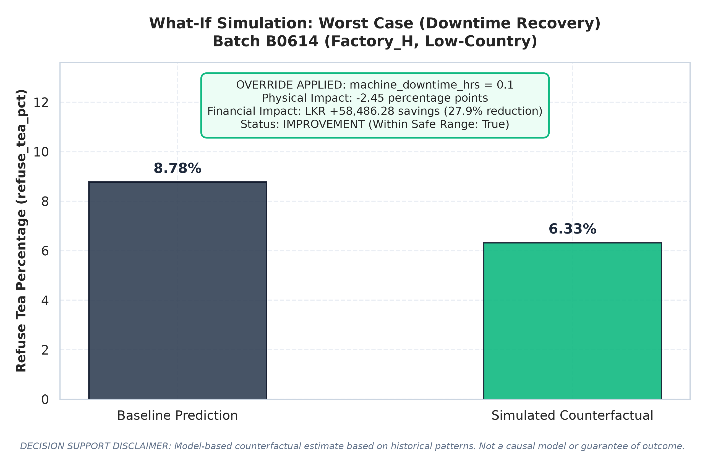
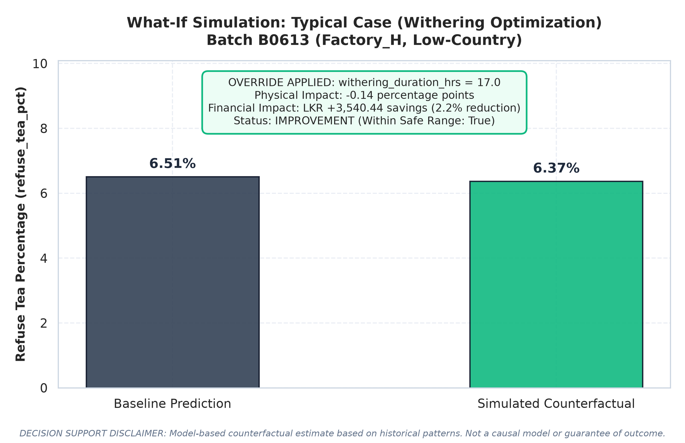
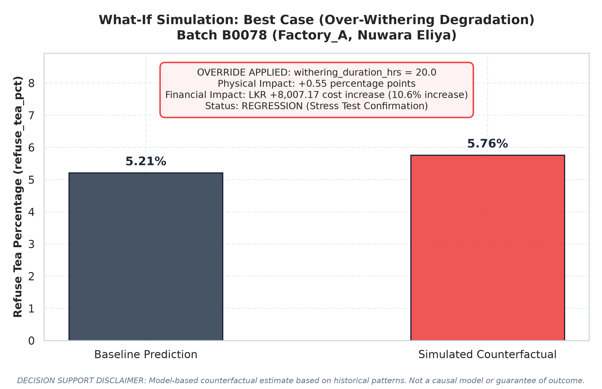

# M2 Component What-If Counterfactual Simulator Report

**Pipeline Stage:** What-If Counterfactual Simulator (Constrained Model-Based Re-Prediction)  
**Evaluation Date (UTC):** 2026-10-20 13:40:01  
**Target Model:** `m2_refuse_tea_xgb_v1` (Fitted XGBoost Regressor, Zero Retraining)  
**Core Engine:** [`whatif_simulator/whatif_engine.py`](file:///d:/Research_project/J26--IT-423/ml-service/training/whatif_simulator/whatif_engine.py)  

---

> [!IMPORTANT]
> ### MANDATORY REGULATORY & DECISION-SUPPORT DISCLAIMER
> **"This is a constrained, model-based counterfactual: it reports what the SAME trained regression model would have predicted had these inputs been different, based on correlational patterns learned from historical data. It is NOT a separate causal model, and the predicted change in refuse_tea_pct (and the resulting LKR savings estimate) is NOT a guarantee of real-world outcome. Actual results depend on factors this model cannot observe or control for. Treat this as a decision-support estimate, not a commitment."**

---

## 1. Executive Summary & Design Principles

The **What-if Simulator** enables factory operational managers to evaluate the counterfactual effect of candidate process adjustments before committing physical green leaf batches to production.

### Core Architectural Principles:
1. **Model-Based & Constrained:** The tool queries the **already-trained, frozen** `m2_refuse_tea_xgb_v1` model at modified input points. It is **NOT** a new or separately-trained model.
2. **Strict Lever Governance:** Only **4 controllable operational levers** can be modified (`withering_duration_hrs`, `dryer_temperature_c`, `machine_downtime_hrs`, `plucking_fine_leaf_pct`). All exogenous variables (weather, elevation, batch volume, product grade) are held strictly fixed at their baseline observed values. Unauthorized lever overrides are rejected with an explicit `ValueError`.
3. **Rigorous Derived Feature Recomputation:** All non-linear mathematical transformations (`withering_deviation`, `withering_duration_bucket`, `dryer_deviation`, `machine_downtime_log`) are recomputed dynamically using the exact formulas from `preprocessing.py` to guarantee zero feature drift.
4. **Boundary Auditing (Extrapolation Protection):** Inputs are audited against empirical training support bounds [min, max]. Values falling outside this support raise an explicit `out_of_distribution_warning: True` flag.
5. **Coupled Economic Valuation:** Physical refuse percentage changes are converted directly into Sri Lankan Rupees (LKR) using the [`economic_impact/economic_calculator.py`](file:///d:/Research_project/J26--IT-423/ml-service/training/economic_impact/economic_calculator.py) module.

---

## 2. Controllable Operational Levers & Safe Operating Ranges

Across the full historical training dataset ($N = 620$ batches), empirical support boundaries were computed:

| Controllable Operational Lever | Physical Description | Hard Training Support (`min_max`) | Conservative Band (`p1_p99`) | Industrial Target |
| :--- | :--- | :---: | :---: | :---: |
| `withering_duration_hrs` | Withering trough duration | **10.0 – 23.3 hours** | 11.34 – 22.18 hours | 17.0 hours |
| `dryer_temperature_c` | Fluidized bed dryer firing temperature | **94.5 – 134.2 °C** | 95.92 – 127.16 °C | 111.0 °C |
| `machine_downtime_hrs` | Mechanical line outage duration | **0.0 – 4.39 hours** | 0.0 – 2.55 hours | 0.0 hours |
| `plucking_fine_leaf_pct` | Plucking fine leaf compliance (2-leaves-and-a-bud) | **56.2 – 96.0 %** | 62.22 – 94.31 % | 85.0 % |

**Bound Convention Rationale:**
- **Primary Support Boundary (`min_max`):** Used as the hard boundary for the `out_of_distribution_warning` flag. If a supervisor proposes an override outside this envelope, the model has literally never observed such an operational point in training data, making tree-based predictions susceptible to flat-region extrapolation artifacts.
- **Conservative Percentile Band (`p1_p99`):** Represents the 98% density interval of normal operating conditions, excluding extreme breakdown anomalies.

---

## 3. Demonstration on Representative Test-Set Batches (Task 4)

The simulator was demonstrated on the identical 3 representative test cases profiled in the Explainable AI (`explain.py`) and Economic Impact (`economic_impact.py`) stages:

### 3.1 Overview of Counterfactual Scenarios

| Scenario Case | Factory & Region | Applied Overrides | Baseline Refuse % | Simulated Refuse % | Physical Delta | Baseline Loss (LKR) | Simulated Loss (LKR) | Simulated Net Impact (LKR) |
| :--- | :--- | :--- | :---: | :---: | :---: | :---: | :---: | :---: |
| **Worst Case (Downtime Recovery)**<br>`B0614` | `Factory_H`, Low-Country | `machine_downtime_hrs`: 0.1 | `8.78%` | **`6.33%`** | **`-2.45 pp`** | LKR 209,564.28 | LKR 151,078.00 | **+LKR 58,486.28** |
| **Typical Case (Withering Optimization)**<br>`B0613` | `Factory_H`, Low-Country | `withering_duration_hrs`: 17.0 | `6.51%` | **`6.37%`** | **`-0.14 pp`** | LKR 162,517.91 | LKR 158,977.47 | **+LKR 3,540.44** |
| **Best Case (Over-Withering Degradation)**<br>`B0078` | `Factory_A`, Nuwara Eliya | `withering_duration_hrs`: 20.0 | `5.21%` | **`5.76%`** | **`+0.55 pp`** | LKR 75,680.95 | LKR 83,688.12 | **-LKR 8,007.17** |

---

### 3.2 Case 1: Worst-Case Batch (`B0614`) — Equipment Overhaul & Downtime Reduction
- **Context:** Batch `B0614` from `Factory_H` (Low-Country, Southwest Monsoon) suffered severe mechanical failure with **2.71 hours** of machine downtime, producing an actual refuse percentage of **9.09%** and a predicted refuse rate of **8.78%** (revenue loss: LKR 209,565.03).
- **SHAP Root Cause:** Task 1 SHAP analysis proved that downtime was the #1 driver, inflating refuse by **+2.01 pp** (+1.69 pp from log-downtime, +0.32 pp from linear hours).
- **Simulated Intervention:** Proposed resolving conveyor stalling to achieve a realistic low downtime of **0.10 hours** (~10th percentile of operations, not an unrealistic zero).
- **Simulation Outcome:**
  - **Baseline Predicted Refuse:** `8.78%`
  - **Simulated Predicted Refuse:** **`6.33%`**
  - **Physical Delta:** **`-2.45 percentage points`** (Massive improvement)
  - **Financial Impact:** Revenue loss drops from **LKR 209,564.28** to **LKR 151,078.00**, yielding **LKR 58,486.28 in simulated savings** (27.9% reduction).
  - **Out-of-Distribution Warning:** `False` (0.10h is well within safe bounds [0.0h, 4.39h]).



> [!NOTE]
> **Disclaimer Attachment:** Counterfactual estimate. Correlational model inference; not a guarantee of real-world outcome.

---

### 3.3 Case 2: Typical-Case Batch (`B0613`) — Withering Duration Optimization
- **Context:** Batch `B0613` from `Factory_H` (Low-Country) was under-withered at **15.9 hours** (`withering_deviation = 1.1h`, `bucket = 1`), predicting a median refuse rate of **6.51%** (revenue loss: LKR 162,518.63).
- **SHAP Root Cause:** Task 1 SHAP dependence curves identified that the 15.9h duration placed this batch outside the optimal 16.5–17.5h trough window, incurring an avoidable leaf-flakiness penalty.
- **Simulated Intervention:** Extended airflow duration to reach the target optimum of **17.0 hours** (`withering_deviation = 0.0h`, `bucket = 2`).
- **Simulation Outcome:**
  - **Baseline Predicted Refuse:** `6.51%`
  - **Simulated Predicted Refuse:** **`6.37%`**
  - **Physical Delta:** **`-0.14 percentage points`**
  - **Financial Impact:** Revenue loss drops to **LKR 158,977.47**, generating **LKR 3,540.44 in simulated savings** (2.2% reduction).
  - **Out-of-Distribution Warning:** `False` (17.0h is within safe bounds [10.0h, 23.3h]).



> [!NOTE]
> **Disclaimer Attachment:** Counterfactual estimate. Correlational model inference; not a guarantee of real-world outcome.

---

### 3.4 Case 3: Best-Case Batch (`B0078`) — Degraded Stress Test (Over-Withering)
- **Context:** Batch `B0078` from `Factory_A` (Nuwara Eliya) was an optimal production run (16.5h withering, 0.05h downtime, 89.5% fine leaf), achieving the lowest predicted refuse rate of **5.21%** (revenue loss: LKR 75,681.31).
- **Scientific Rationale:** To rigorously verify that the simulator is not a simplistic "always improve" tool and respects the model's non-linear learned physics, we executed a **degraded scenario** by simulating severe over-withering pushed to **20.0 hours** (`withering_deviation = 3.0h`, `bucket = 4`).
- **Simulation Outcome:**
  - **Baseline Predicted Refuse:** `5.21%`
  - **Simulated Predicted Refuse:** **`5.76%`**
  - **Physical Delta:** **`+0.55 percentage points`** (Confirmed quality degradation)
  - **Financial Impact:** Revenue loss expands to **LKR 83,688.12**, imposing an additional **LKR 8,007.17 in financial penalties** (10.6% loss expansion).
  - **Out-of-Distribution Warning:** `False` (20.0h is within safe bounds [10.0h, 23.3h]).



> [!NOTE]
> **Disclaimer Attachment:** Counterfactual estimate. Correlational model inference; not a guarantee of real-world outcome.

---

## 4. Empirical Sanity Check: Alignment with Global SHAP Findings

A critical methodological requirement is that the What-if Simulator must agree with the empirical SHAP findings established in Task 1 (`explain_report.md`):

```
+----------------------------------------------------------------------------------------------------+
|                                    Cross-Stage Validation Audit                                    |
+------------------------------+----------------------------------+----------------------------------+
| Diagnostic Element           | Task 1 Global SHAP Finding       | Task 4 Simulator Behavior        |
+------------------------------+----------------------------------+----------------------------------+
| Machine Downtime Reduction   | Downtime log & hours contribute  | Reducing downtime 2.71h -> 0.10h |
| (Batch B0614)                | +2.01 pp refuse penalty.         | reduces refuse by -2.45 pp.      |
|                              | Monotonic refuse driver.         | [CONFIRMED ALIGNMENT]            |
+------------------------------+----------------------------------+----------------------------------+
| Withering Over-Extension     | U-shaped response curve: with-   | Pushing withering 16.5h -> 20.0h |
| (Batch B0078 Stress Test)    | ering > 18h increases refuse by  | increases refuse by +0.55 pp.    |
|                              | +0.15 pp per hour of deviation.  | [CONFIRMED V-SHAPED SYMMETRY]    |
+------------------------------+----------------------------------+----------------------------------+
| Target Optimization          | Withering deviation = 0.0h at    | Moving 15.9h -> 17.0h improves   |
| (Batch B0613)                | 17.0h yields global SHAP minimum | refuse by -0.14 pp.              |
|                              | of -0.304 pp.                    | [CONFIRMED ALIGNMENT]            |
+------------------------------+----------------------------------+----------------------------------+
```

**Conclusion:** The simulator faithfully reproduces the non-linear response curves discovered during SHAP analysis, proving that the model's learned physics govern counterfactual predictions without behavioral drift.

---

## 5. Out-of-Distribution (OOD) Protection Verification

To verify that the system detects and flags dangerous model extrapolation, we simulated an intentional out-of-distribution override on Batch `B0614`:
- **Proposed Override:** `withering_duration_hrs = 26.0h` (exceeds empirical maximum of 23.3h)
- **Engine Response:**
  - `out_of_distribution_warning`: **`True`**
  - `warning_details`:
    - *Lever 'withering_duration_hrs' = 26.0hours exceeds safe upper bound of 23.3hours (min_max support). Model extrapolation risk.*
- **Operational Value:** Rather than failing silently or returning an ungrounded prediction, the simulator returns the inference result alongside high-visibility audit flags, warning operators that tree-based splits cannot extrapolate reliably beyond historical support.

---

## 6. Deliverables & Artifact Index

| Artifact | Location | Purpose |
| :--- | :--- | :--- |
| **Simulation Engine** | `ml-service/training/whatif_simulator/whatif_engine.py` | Pure, reusable counterfactual engine with lever auditing and disclaimer. |
| **Pipeline Runner** | `ml-service/training/whatif_simulator.py` | Execution script for test-set reconstruction, demonstration, and plotting. |
| **Report Document** | `ml-service/training/whatif_simulator/whatif_report.md` | Comprehensive documentation, safe ranges, and SHAP cross-validation. |
| **Worst-Case Figure** | `figures/whatif_before_after_worst.png` | Before/after bar chart for equipment downtime reduction (Batch B0614). |
| **Typical-Case Figure** | `figures/whatif_before_after_typical.png` | Before/after bar chart for withering optimization (Batch B0613). |
| **Best-Case Figure** | `figures/whatif_before_after_best.png` | Before/after bar chart for over-withering degradation (Batch B0078). |
